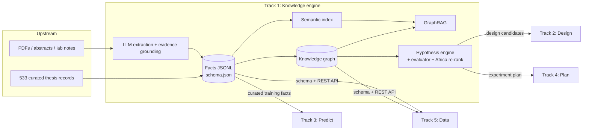

# Pipeline Position

**Stage:** Knowledge (Track 1)

**Upstream inputs:** PDFs, abstracts (OpenAlex / Crossref), patents and lab notes as text, curated datasets
(the 533-record AHSC/LLZO thesis dataset).

**Downstream outputs:** structured evidence-grounded facts (JSONL), a knowledge graph (GraphML), research maps
(centrality, co-occurrence, gaps), and ranked hypotheses with validation experiments (JSON / Markdown).

## Integration

| Track | What it receives | Format | Where |
|---|---|---|---|
| Track 2 (Design) | Ranked candidate compositions with target property, priority, Africa score and evidence fact ids | `track2_design_candidates.json` | App → Hypothesis Generator download, `POST /hypotheses` → `track2_design_candidates` |
| Track 3 (Predict) | Curated, unit-checked, quality-flagged training facts (the thesis RF/GB models consume these) | `data/thesis_facts.jsonl` | `GET /facts?property=...&min_confidence=0.9` |
| Track 4 (Plan) | One validation experiment per hypothesis: technique, max processing temperature, success metric, priority | `track4_experiment_plan.json` | App download, `POST /hypotheses` → `track4_experiment_plan` |
| Track 5 (Data) | Ontology, fact schema, graph export, REST API with OpenAPI docs | `schema.json`, `knowledge_graph.graphml`, `/docs` | `GET /schema`, `GET /graph/{material}` |

## Contracts

- Every fact carries `evidence_span` (verbatim), `source` (record id / DOI), `confidence` and `quality_flags`.
- Every hypothesis carries `supporting_fact_ids`, which resolve to facts, and per-criterion scores.
- Units follow `schema.json → properties_vocabulary`. Non-standard units are kept as reported, never silently converted.
