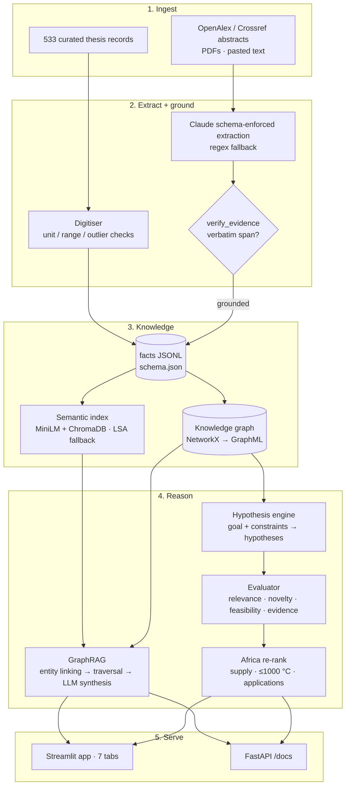

# African Battery Materials Knowledge Engine

**An LLM-powered knowledge engine that ingests materials literature, extracts structured facts with evidence
grounding, constructs a knowledge graph, and generates testable hypotheses under African constraints. It is
validated on 533 curated records from asymmetric hybrid supercapacitor (AHSC) and garnet LLZO solid-electrolyte
research.**

Materials GPT Hackathon · **Track 1: Literature mining → structured knowledge → knowledge graphs → hypothesis generation**

| | |
|---|---|
| Curated literature records | **533** (369 AHSC, 164 LLZO) → **1,238 evidence-grounded facts** in `data/thesis_facts.jsonl`, plus 36 grounded facts mined from 37 source papers and reviews (`data/literature_facts.jsonl`) |
| Source linking | 265 of 533 records linked to literature: **34 paper DOIs** (24 verified against the paper's own values, 10 by exact title), 10 verified papers without a visible DOI, 57 rows traced to a verified source-review table and 186 more by block inference (`data/record_sources.csv`, provenance in `data/provenance/`) |
| Evidence grounding | **100 %** of curated facts; mined facts must pass verbatim-span verification |
| Extraction benchmark | rule-based baseline **P = 0.96, R = 0.84, F1 = 0.89** against the curated facts (`reports/extraction_validation.json`) |
| Knowledge graph | **1,319 nodes / 5,022 edges** across 8 node types (`data/knowledge_graph.graphml`) |
| Africa layer | element-supply score on every fact, node and hypothesis; ≤ 1000 °C processing constraint |
| Openness | REST API with OpenAPI docs, JSON schema + ontology, MIT code / CC BY 4.0 data, CITATION.cff, CI |

## Architecture



The LLM is the reasoning engine for extraction, entity linking, GraphRAG synthesis, hypothesis generation and
hypothesis judging. Every LLM step has a transparent offline fallback (regex extraction, lexicon entity linking,
statistics-based answers, graph-template hypotheses). The app, API and tests therefore run without an API key,
and every output reports which mode produced it.

## Quick start

```bash
python -m pip install -r requirements.txt
python -m knowledge_engine.pipeline         # build facts, graph and reports (~10 s)
streamlit run app.py                        # the knowledge-engine app
uvicorn api:app --reload                    # REST API, docs at http://127.0.0.1:8000/docs
pytest -q                                   # 30 offline tests
```

To enable the LLM, copy `.env.example` to `.env` and set `ANTHROPIC_API_KEY`. `OPENAI_API_KEY` also works as
an alternative. For neural embeddings with ChromaDB, run `pip install -r requirements-semantic.txt`. Without
it, search uses a scikit-learn LSA index.

## The app

| Tab | Function | Track 1 requirement |
|---|---|---|
| **Literature Explorer** | GraphRAG Q&A with fact-level citations, semantic search with an Africa filter, PDF/abstract extraction | Literature mining |
| **Knowledge Graph** | Interactive PyVis graph around a family, material, element or dopant; GraphML download | Knowledge graph |
| **Hypothesis Generator** | Goal + constraints → ranked hypotheses; JSON, Markdown, Track 2 and Track 4 exports | Hypothesis generation |
| **Research Map** | Centrality, family × property coverage heat-map, gap analysis, property co-occurrence, LLZO dopant summary | Research maps |
| **Africa Focus** | Element-supply table, best Africa-compatible materials, supply vs performance, composition checker | Africa relevance |
| **Data Quality** | Grounding rate, extraction precision/recall per property, quality flags, flagged-fact review | Scientific rigour |
| **Thesis Analytics** | The original performance explorer and RF specific-power model | Bridge to Track 3 |

## Modules

| Feedback deliverable | Implementation |
|---|---|
| `data/thesis_facts.jsonl` | `knowledge_engine/facts.py`: one fact per reported property with material, family, elements, dopants, value, unit, condition, source, verbatim evidence span, confidence, quality flags and Africa profile |
| `schema.json` + ontology README | [`schema.json`](schema.json), [`docs/ONTOLOGY.md`](docs/ONTOLOGY.md) |
| Semantic index (ChromaDB/FAISS) | `knowledge_engine/search.py`: sentence-transformers `all-MiniLM-L6-v2` + persistent ChromaDB, or a TF-IDF + SVD fallback |
| Corpus expansion (`data/literature/`, `metadata.json`) | `knowledge_engine/literature.py`: OpenAlex search with Africa-relevant queries, Crossref DOI lookup, abstract mining |
| `extraction.py` + precision/recall | `knowledge_engine/extraction.py`: Claude structured-output extraction, regex fallback, PDF support, `validate()` benchmark |
| `verify_evidence()` + ≥ 95 % grounding report | `knowledge_engine/evidence.py`; `reports/data_quality.json` |
| `knowledge_graph.py` + GraphML | `knowledge_engine/knowledge_graph.py`: build, centrality, co-occurrence, gap analysis, sparse cells, dopant effects, GraphML export |
| `graph_rag.py` | `knowledge_engine/graph_rag.py`: entity extraction → neighbourhood + semantic retrieval → cited synthesis |
| `hypothesis_engine.py` | `knowledge_engine/hypothesis_engine.py`: goal parsing, KG context, LLM generation, offline generator |
| `hypothesis_evaluator.py` | `knowledge_engine/hypothesis_evaluator.py`: relevance, novelty, feasibility, evidence, Africa re-rank, exports |
| Africa constraints | `knowledge_engine/africa.py`, `data/africa_element_supply.csv` |
| `api.py` with `/docs` | [`api.py`](api.py): `/extract`, `/ask`, `/hypotheses`, `/graph/{material}`, `/facts`, `/search`, `/research-map`, `/africa/constraints`, `/schema` |
| `PIPELINE.md`, LICENSE, CONTRIBUTING, CITATION | [`PIPELINE.md`](PIPELINE.md), [`LICENSE`](LICENSE), [`CONTRIBUTING.md`](CONTRIBUTING.md), [`CITATION.cff`](CITATION.cff) |

## Command line

```bash
python -m knowledge_engine.facts                                   # rebuild thesis_facts.jsonl
python -m knowledge_engine.extraction --validate                   # benchmark (add --llm --limit 40 for Claude)
python -m knowledge_engine.extraction paper.pdf                    # extract grounded facts from a PDF
python -m knowledge_engine.literature harvest --per-query 40       # grow the corpus (needs network)
python -m knowledge_engine.literature provenance                   # add verified source papers to the corpus
python -m knowledge_engine.literature mine                         # mine abstracts → data/literature_facts.jsonl
python -m knowledge_engine.record_sources build                    # rebuild data/record_sources.csv from provenance
python -m knowledge_engine.record_sources resolve                  # Crossref: value-verified DOIs for the rest
python -m knowledge_engine.knowledge_graph                         # GraphML + reports/research_map.json
python -m knowledge_engine.graph_rag "What dopants improve LLZO ionic conductivity?"
python -m knowledge_engine.hypothesis_engine "Reduce LLZO sintering temperature below 1000°C"
```

## How Africa is structural, not a tab

1. **Ingestion:** literature queries target chemistries built from African-supplied elements (Mn, Fe, Ti, Zr,
   graphite and biomass carbon) alongside the core AHSC/LLZO topics.
2. **Facts and graph:** every fact and Material node carries an Africa supply score. Element nodes link to
   supplying countries. Cobalt, tantalum, tin and tungsten carry responsible-sourcing flags.
3. **Retrieval:** semantic search and hypothesis context can be filtered or weighted by supply score.
4. **Hypotheses:** constraints (preferred elements, ≤ 1000 °C processing, off-grid solar / EV / grid storage)
   go into generation. A final re-rank blends 75 % scientific score with 25 % African feasibility.

## Scientific caveats

- Source links are conservative. A paper DOI is attached to a curated record only when the paper's own text
  shows the record's material and values (or its exact title names the material), and the verbatim sentence is
  stored in `data/provenance/doi_search_log.jsonl`. Records compiled from a review table also carry the review's
  DOI, marked `verified_row` (row checked against the review) or `block_inferred` (same table block, not checked
  row by row). Remaining records cite the curated file and line. To extend coverage where `api.crossref.org` is
  reachable, run `python -m knowledge_engine.record_sources resolve`, which accepts only value-verified matches.
- Grounding for curated facts is checked against each record's raw cell text. The extraction benchmark uses
  sentences generated from those raw cells. It measures value/unit/property extraction, not full-paper reading.
- Supply statuses and 2024 production figures were checked against USGS *Mineral Commodity Summaries 2025*
  (each row of `data/africa_element_supply.csv` records its verification level). They are not reserve estimates or
  investment advice.
- Hypotheses are research suggestions to test, not conclusions. Each one lists its evidence and a validation
  experiment, and offline "domain prior" hypotheses are labelled as such.

## Original analysis pipeline

`ahsc_llzo_analysis.py` (the Python port of the thesis R workflow) still produces the descriptive statistics,
Mann–Whitney U tests, distribution plots and the AHSC random-forest model:

```bash
python ahsc_llzo_analysis.py     # outputs to results/ and plots/
```

## Licence and citation

Code: MIT. Curated data and knowledge artefacts: CC BY 4.0 (see [`LICENSE`](LICENSE)). Please cite using
[`CITATION.cff`](CITATION.cff), and cite the original publications behind each fact.
